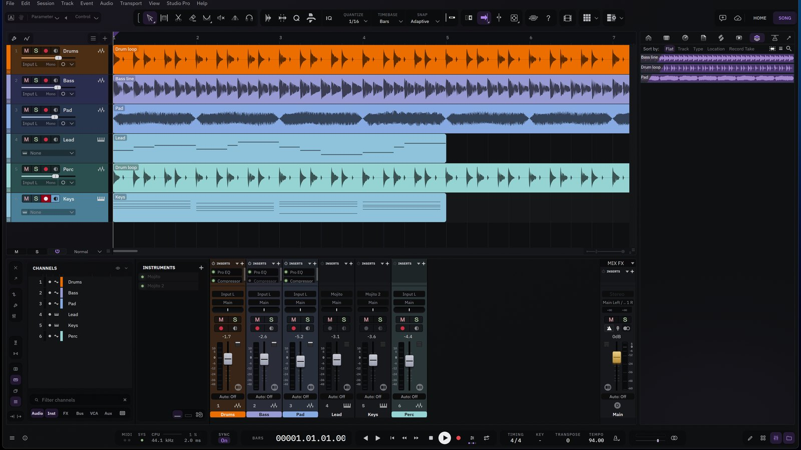
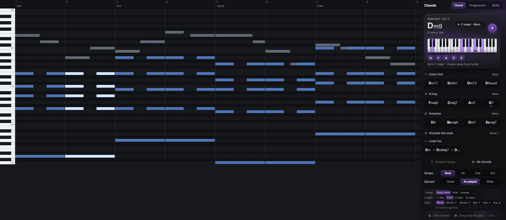
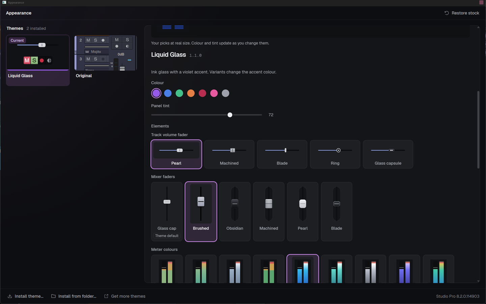
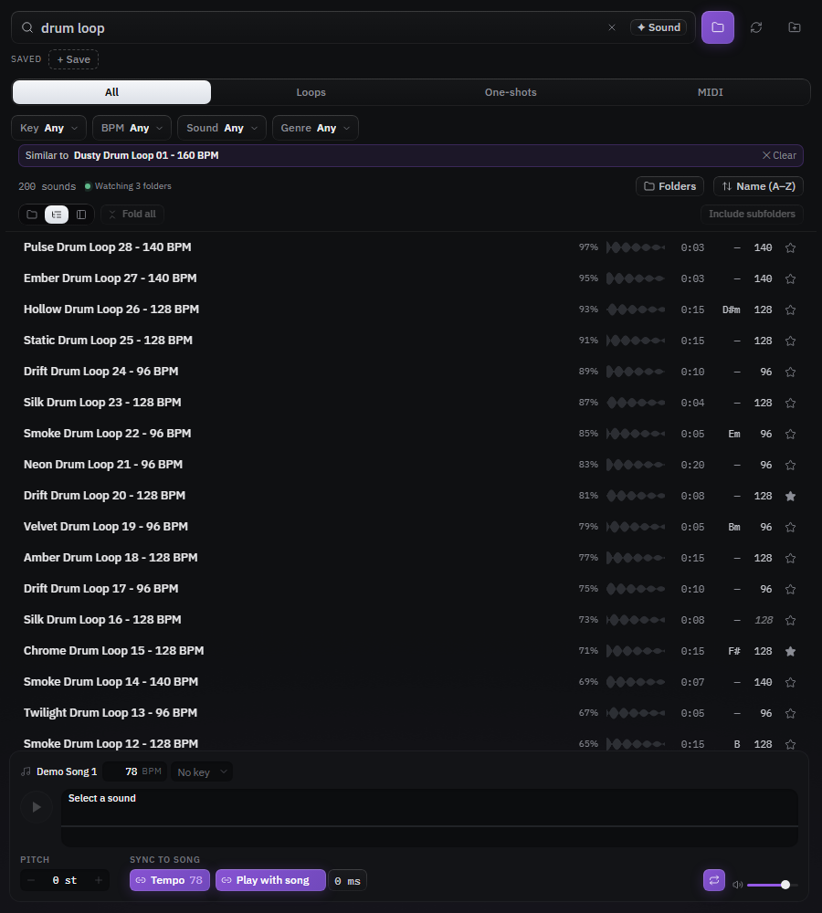

# Fender Studio Pro X

Free community mods for **Fender Studio Pro 8.2** on Windows: a chords panel, pitch curves you draw, smarter sound search, ready-made themes with an Appearance window, a chat assistant, a calmer Start page and more. Take only the parts you want, and go back to plain Studio Pro with one click.

> Heads up: I'm a producer, not a programmer. I build these mods with AI coding tools and test each release on my own setup, on one Studio Pro build. They change how Studio Pro looks and works, so things can still break, especially after a Studio Pro update. Back up your songs first, use it at your own risk, and if anything acts up, run the uninstaller to go back to stock.

- Made for **Studio Pro 8.2 (build 8.2.0.114903)**, Windows 10 and 11. On another build the pack starts Studio Pro stock-looking and says what it turned off. Still on Studio Pro 8.1.2? Use release 1.4.1.
- The mods **never touch licensing, sign-in, activation or subscriptions**.
- **No sign-in, licence or program code of Fender's is shipped.** Themes come ready-made.
- Unofficial fan project, vibe-coded, so expect bugs. Not made or supported by Fender or PreSonus. Studio One and Studio Pro are trademarks of their owners.

## Download

Get the latest zip from **[Releases](../../releases/latest)**.

**2.0.0** is a big update: a **Chords panel** in the piano roll, **Expression mode** for pitch curves, a smarter **Sound search** (find similar sounds, tags, saved searches, watched folders), the **Appearance window** with ready-made themes (Liquid Glass in seven accents and Original), **skin options** for faders, M/S/R, meters and the transport bar (Console, Island, Classic), a **chat assistant** that uses your own Claude Code subscription, and small extras. Full list: [CHANGELOG.md](CHANGELOG.md). Upgrading from 1.4.1: run Install.bat again, your settings are kept.

## See it

- **[Open the presentation in your browser](https://ferrerokush-png.github.io/fender-studio-pro-x/)**: the full feature tour as a web page.
- **[Presentation (PDF)](presentation/Fender%20Studio%20Pro%20X%20-%20Presentation.pdf)**: every mod with pictures.
- **[Feature sheet](https://ferrerokush-png.github.io/fender-studio-pro-x/presentation/feature-sheet.html)**: everything on one page ([PDF](presentation/Fender%20Studio%20Pro%20X%20-%20Feature%20Sheet.pdf)).
- **[Install guide](presentation/install-guide.md)**: step by step, from unzipping to going back to stock.

## Screenshots

**Chords panel**: see and swap chords in the piano roll, with ghost notes before you commit.

**Appearance window**: pick a theme, then change faders, M/S/R buttons, meters and the transport bar.

**Sound search**: find samples in your own folders by type, key and tempo, or by how they sound.

Pictures use a demo song and demo sample folders.

## The 12 packages

You can install any mix of these. If a package needs another one, the installer adds it and tells you.

| # | Package | What it does |
|---|---|---|
| 01 | Skins | Ready-made themes (Liquid Glass in seven accents and Original) and the Appearance window, with options for faders, M/S/R, meters and the transport bar. |
| 02 | Home page | A calm Start page: your sessions, a Quick start card with your templates (one click starts a song), music news, your artist card and your audio device. |
| 03 | Name and icon | "Fender Studio Pro X" in the title bar and the X app icon. |
| 04 | Track List | A redesigned Track List with saved views, search and quick show/hide. |
| 05 | Plug-in browser | Instruments and Effects as a modern panel: filters, favourites, folders and search. |
| 06 | Sound search | Find samples by name, type, key, tempo or by how they sound (needs a small sound model you get once from the release page). Tags, saved searches, watched folders, paste at the playhead. MIDI files and in-time previews too. |
| 07 | YouTube panel | Search YouTube audio in Browser > Cloud, preview it with a volume slider and bring it into your song. Optional Account tab: your Home, Subscriptions, Liked, Watch later and History (needs yt-dlp and ffmpeg). |
| 08 | Look extras | Smooth motion, glass pop-up menus, rounded ruler markers and loop. |
| 09 | Pitch curves | Expression mode: draw, edit and shape a pitch line for each note in the piano roll. |
| 10 | AI tools | A chat assistant that can drive Studio Pro, using your own Claude Code subscription (install and sign in yourself, no keys stored), and optional better stems. |
| 11 | Chords panel | See and swap chords in the piano roll, ideas that fit your key, build into empty bars, ghost notes before you commit. Chord statistics: Chordonomicon dataset, CC BY-NC 4.0, free use only. |
| 12 | Small extras | A free-Hz arpeggiator rate and a fix for some docked plug-in windows. |

A small **Core** (the mod loader and a crash guard for web panels) is always installed and never listed.

## Install in 3 lines

1. Close Studio Pro and unzip the download anywhere.
2. Double-click **Install.bat**, tick the packages you want, check the summary, press Install.
3. Start Studio Pro. If you installed Skins, open the **Appearance** window to pick a theme.

The full guide: **[install guide](presentation/install-guide.md)**. The download has its own `README.md` too.

## Go back to stock

- For one start: hold **Shift** while Studio Pro starts.
- For good: close Studio Pro and run **Uninstall.bat** from the download. Studio Pro is exactly stock again.

## Talk to us

- **[Discussions](../../discussions)** is the place to talk.
  - **Ideas**: suggest something or vote on an idea.
  - **Q&A**: ask for help.
  - **Show and tell**: show what you made or changed.
- **[Issues](../../issues)** is for bugs. Please use the form; it asks for the few details that help most.

New here? See [CONTRIBUTING.md](CONTRIBUTING.md). Please be kind: [CODE_OF_CONDUCT.md](CODE_OF_CONDUCT.md).

## Build your own mods

Want to build your own mods? Give the **[For your AI agent](For%20your%20AI%20agent)** folder to Claude or another AI agent. It explains how Studio Pro works inside, so your agent can start building right away. Work in a copy of Studio Pro, never your only install.

## Licence

Our own code and files are MIT licensed (see [LICENSE](LICENSE)). Third-party models, datasets and tools keep their own licences (chord statistics: CC BY-NC 4.0); they are listed in `THIRD-PARTY-NOTICES.md` inside the download. Thanks to the Studio One team at Fender: this only exists because the program underneath is so good to work in.
