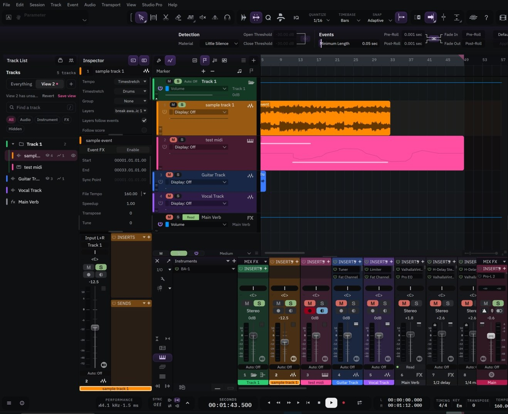
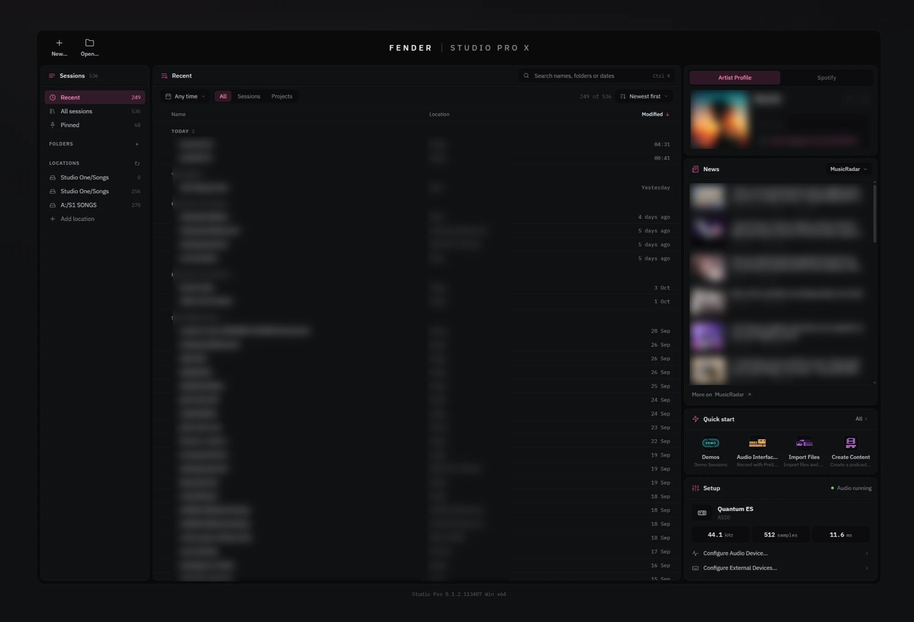
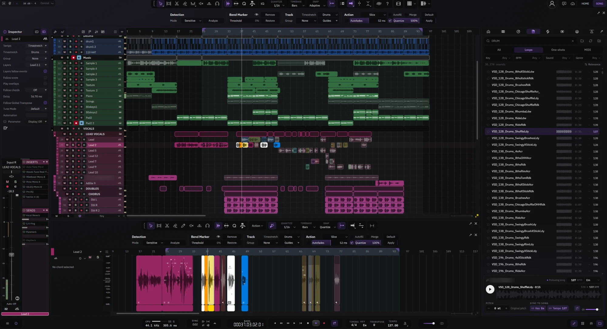

# Fender Studio Pro X

Free community mods for **Fender Studio Pro 8** on Windows: skins, a calmer Start page, a redesigned Track List and plug-in browser, sample search, AI tools and more. Take only the parts you want, and go back to plain Studio Pro with one click.

> Heads up: these mods are completely vibe-coded. I'm not a programmer. I built all of this with AI and I honestly don't know what I'm doing, so expect bugs and things that break. Back up your songs first, use it at your own risk, and if anything acts up, run the uninstaller to go back to stock.

- Tested on **Studio Pro 8.1.2 (build 8.1.2.113407)**, Windows 10 and 11.
- The mods **never touch licensing, sign-in, activation or subscriptions**.
- **No Fender files are shipped.** Skins are built on your PC from your own copy of Studio Pro.
- Unofficial fan project, not made or supported by Fender. Studio One and Studio Pro are trademarks of their owners.

## Download

Get the latest zip from **[Releases](../../releases/latest)**.

**New in 1.2.1:** a cleaner, calmer Sound search look. **1.2.0** brought a much faster Sound search that also plays MIDI files on the selected track, and a Quick start card on the Home page.

## See it

- **[Open the presentation in your browser](https://ferrerokush-png.github.io/fender-studio-pro-x/)**: the full feature tour as a web page.
- **[Presentation (PDF)](presentation/Fender%20Studio%20Pro%20X%20-%20Presentation.pdf)**: every mod with pictures.
- **[Feature sheet](https://ferrerokush-png.github.io/fender-studio-pro-x/presentation/feature-sheet.html)**: everything on one page ([PDF](presentation/Fender%20Studio%20Pro%20X%20-%20Feature%20Sheet.pdf)).
- **[Install guide](presentation/install-guide.md)**: step by step, from unzipping to going back to stock.

## Screenshots

**Start page**: your sessions, music news, one-click Quick start templates and your audio setup in one calm page.

**Sound search**: find samples in your own folders by type, key and tempo, and hear them matched to your song.

Session, collaborator and artist names are blurred in these pictures.

## The 10 packages

You can install any mix of these. If a package needs another one, the installer adds it and tells you.

| # | Package | What it does |
|---|---|---|
| 01 | Skins | Liquid Glass and Graphite, built on your PC from your own Studio Pro, with a Skins page in Options and live colour changes. |
| 02 | Home page | A calm Start page: your sessions, a Quick start card with your templates (one click starts a song), music news, your artist card and your audio device. |
| 03 | Name and icon | "Fender Studio Pro X" in the title bar and the X app icon. |
| 04 | Track List | A redesigned Track List with saved views, search and quick show/hide. |
| 05 | Plug-in browser | Instruments and Effects as a modern panel: filters, favourites, folders and search. |
| 06 | Sound search | Find samples by name, type, key and tempo in Browser > Files, matched to your song. MIDI files play on the selected instrument track too. |
| 07 | YouTube panel | Search YouTube audio in Browser > Cloud, preview it and bring it into your song (needs yt-dlp and ffmpeg). |
| 08 | Look extras | Smooth motion, glass pop-up menus, rounded ruler markers and loop. |
| 09 | Pitch curves | Draw and edit per-note pitch curves in the piano roll. |
| 10 | AI tools | A chat assistant that can drive Studio Pro, the AI Lab tab, and optional better stems. |

A small **Core** (the mod loader and a crash guard for web panels) is always installed and never listed.

## Install in 3 lines

1. Close Studio Pro and unzip the download anywhere.
2. Double-click **Install.bat**, tick the packages you want, check the summary, press Install.
3. Start Studio Pro. If you installed Skins, open **Options > Skins** to pick a look.

The full guide is inside the download: `presentation\install-guide.md` (and the pack's own `README.md`).

## Go back to stock

- For one start: hold **Shift** while Studio Pro starts.
- For good: close Studio Pro and run **Uninstall.bat** from the download. Studio Pro is exactly stock again.

## Talk to us

- **[Discussions](../../discussions)** is the place to talk.
  - **Ideas**: suggest something or vote on an idea.
  - **Q&A**: ask for help.
  - **Show and tell**: show what you made or changed.
- **[Issues](../../issues)** is for bugs. Please use the form; it asks for the few details that help most.

New here? See [CONTRIBUTING.md](CONTRIBUTING.md). Please be kind: [CODE_OF_CONDUCT.md](CODE_OF_CONDUCT.md).

## Build your own mods

Want to build your own mods? Give the **[For your AI agent](For%20your%20AI%20agent)** folder to Claude or another AI agent. It explains how Studio Pro works inside, so your agent can start building right away. Work in a copy of Studio Pro, never your only install.

## Licence

Our own code and files are MIT licensed (see [LICENSE](LICENSE)). Third-party models and tools keep their own licences; they are listed in `THIRD-PARTY-NOTICES.txt` inside the download. Thanks to the Studio One team at Fender: this only exists because the program underneath is so good to work in.
