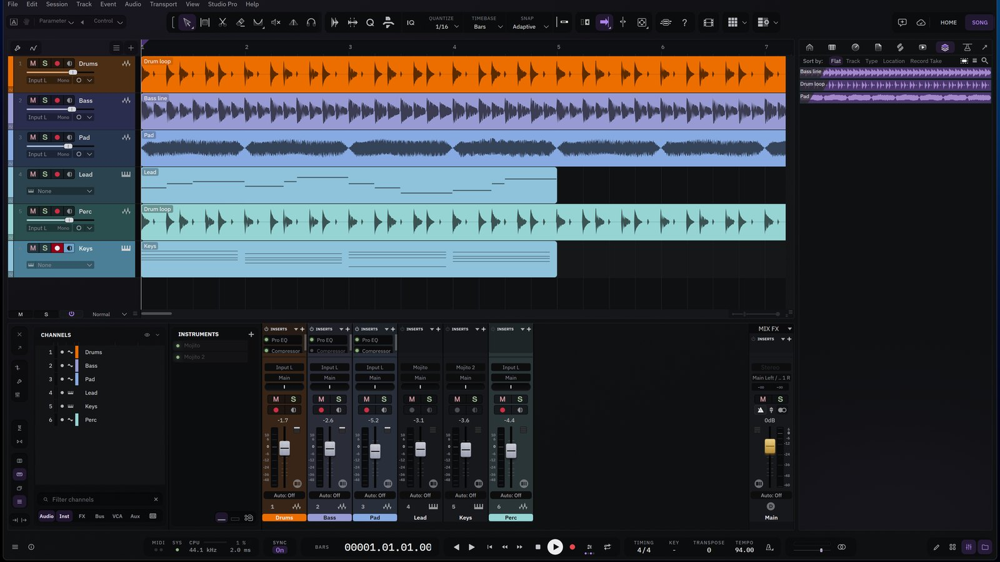

# Fender Studio Pro X 2.0.0: free fan mods for Studio Pro 8.2

> **Heads up: this is vibe-coded, so expect bugs.** I'm a producer, not a programmer. I build these mods with AI coding tools and test each release on my own setup, on one Studio Pro build (8.2.0.114903). They change how Studio Pro looks and works, so things can still break, especially after a Studio Pro update. Back up your songs first, use it at your own risk, and if anything acts up, run the uninstaller to go back to stock.

I have been shaping Studio Pro 8 into the DAW I always wanted to work in, and I am sharing the result for free. **Fender Studio Pro X** is a set of mods and themes that sit on top of **your own, licensed** Studio Pro 8 and give you your own version of it.

It is a free fan project: no price, no ads, no tracking. It installs on the copy you already own, it never touches licensing, sign-in or activation, and one click takes you back to plain Studio Pro. No sign-in, licence or program code of Fender's is shipped. It is unofficial and not affiliated with Fender or PreSonus.

**Version 2.0.0 is made for Studio Pro 8.2 (build 8.2.0.114903) on Windows 10 or 11, and comes in 12 packages.** Tick the ones you want, with a few switches inside each. The installer adds what a package needs and shows you a summary before it changes anything. Still on Studio Pro 8.1.2? Keep using 1.4.1.

## New in 2.0.0

- **Appearance window.** Pick a ready-made theme (Liquid Glass in seven accent colours, or Original), press Apply, and your song is saved and reopens with the new look. Themes come ready-made, so nothing is built on your PC any more.
- **Skin options.** Choose the track volume fader, mixer faders, meters (including a spectrum look), the M/S/R buttons, track header text and the transport bar (Console, Island or Classic).
- **Chords panel** beside the piano roll: see and swap the chords of what you play, ideas that fit your key, build into empty bars, ghost notes before you commit, and a play style (your own timing, strum or arpeggio). It needs the bridge part of the AI tools package, which the installer adds for you.
- **Pitch curves** is now a full Expression mode: draw, edit and shape a pitch line for each note, one Undo per gesture.
- **Sound search** also finds sounds by how they sound (to search by how sounds sound, get the small sound model once: download `FSPX-sound-model.zip`, about 190 MB, from the release page, unzip it anywhere and double click `Install-Sound-Model.bat`; everything else in Sound search works without it), plus tags, saved searches, watched folders and paste at the playhead.
- **Chat assistant** (off at first): talk to your song using **your own Claude Code subscription**. Install Claude Code and sign in yourself; no keys are stored or shipped, and it uses your own Claude plan limits. It can read and change tracks, mixing, sends, plug-in settings, MIDI and automation. Other MCP programs can use the same bridge, which listens on your PC only.
- **Small extras:** any rate in Hz for the arpeggiator, and a fix for some docked plug-in windows that showed up blank or too small.

*Pictures use a demo song.*

## The 12 packages

**1. Skins (Appearance window).** Ready-made themes and the Appearance window, with options for faders, M/S/R, meters and the transport bar.

**2. Home page.** A calm Start page: your sessions, a Quick start card (one click starts a song from your template), music news, your artist card and your audio device. *Brings Skins with it.*

**3. Name and icon.** "Fender Studio Pro X" in the title bar and the X app icon.

**4. Track List.** A redesigned Track List: eye buttons, search, filters, folders, colours and saved views. *Brings Skins with it.*

**5. Plug-in browser.** Instruments and Effects as a modern panel: filters, favourites, your own folders and search. *Brings Skins with it.*

**6. Sound search.** Find samples by name, type, key, tempo, tags and sound, preview in time with the song, drag it in. MIDI files play too, on the track you have selected. *Brings Skins with it.*

**7. YouTube panel** (off at first). Search or paste a link in the Cloud tab, preview, and bring the audio into the song's folder. Uses yt-dlp and ffmpeg, which you install yourself. Only use audio you have the right to use. *Brings Skins with it.*

**8. Look extras.** Smooth motion, glass pop-up menus, rounded ruler markers and loop.

**9. Pitch curves.** Expression mode: draw, edit and shape a pitch line for each note in the piano roll.

**10. AI tools** (off at first). The chat assistant and bridge (it needs your own Claude Code subscription, installed and signed in by you) and optional better stems. Better stems is a big download and the installer asks first. An AI Lab installed with 1.4.x is kept on upgrade; it is no longer part of the pack.

**11. Chords panel.** The Chords column beside the piano roll. Brings Pitch curves, Sound search and the AI tools bridge along. Chord statistics come from the Chordonomicon dataset (CC BY-NC 4.0, free use only).

**12. Small extras.** A free-Hz arpeggiator rate and a docked plug-in editor fix.

Underneath it all sits **Core**, always installed: the mod loader and a crash guard for web panels.

## The promise

- Licensing stays untouched. No changes to sign-in, activation, subscriptions or the store.
- No sign-in, licence or program code of Fender's is shipped.
- Where a package replaces a stock file, the original is kept and Uninstall puts it back.
- Hold **Shift** while Studio Pro starts for the stock look. Run the top-level **Uninstall.bat** and Studio Pro is exactly stock again. Each package also has its own Uninstall.bat.
- Our code is MIT licensed. Third-party models, datasets and tools keep their own licences.

## Honest limits

- Windows only. Made for one Studio Pro build, 8.2.0.114903. After a Studio Pro update, run Install.bat again and expect that some parts stay off until they are updated.
- Vibe-coded and tested on one setup: expect bugs, and back up your songs first.
- The chat spends your own Claude plan limits. The mixing tools need Python 3.12 or newer.
- Some parts of Studio Pro are drawn by the program itself and a theme cannot change them.

## Get it

Install steps: see the [install guide](install-guide.md). Questions and bugs: see [community](community.md).
Download (free): **https://github.com/ferrerokush-png/fender-studio-pro-x** (Releases has the latest zip). Take the tour: https://ferrerokush-png.github.io/fender-studio-pro-x/

Huge thanks to the Studio One team at Fender. This only exists because the program underneath is so good to work in.

*A free fan project, not for sale. Not made or supported by Fender or PreSonus. Studio One and Studio Pro are trademarks of their owners.*
